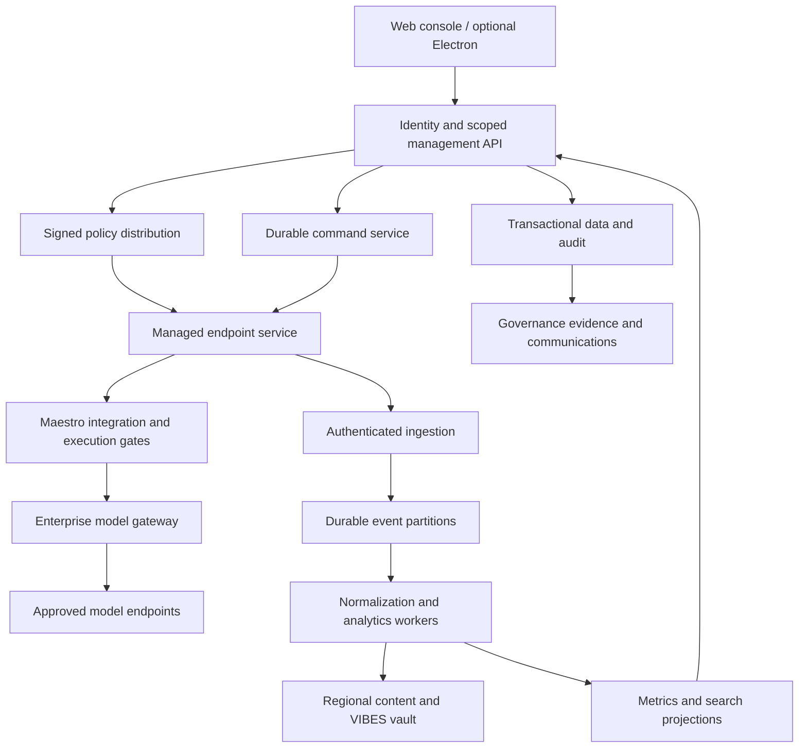

# Mega-Maestro

Execution amendment: [[MEGA-MAESTRO-ENFORCEABILITY]] defines early real-provider/backend proof, protected management binding, outage semantics and explicit dependency gates. Read it with [[MEGA-MAESTRO-INTEGRATION]] before implementing this design.

## 1. Product decision and scope

Mega-Maestro is a separate enterprise application for governing and operating a fleet of Maestro installations. The product includes the console, central services, a managed endpoint component, and enterprise integration in Maestro. It supports hosted SaaS and customer-operated deployments from the same artifacts.

Confirmed requirements: both deployment models; separate application repository; 10,000-plus instances; configurable content collection up to full available VIBES data per selected scope; enterprise policy takes precedence over every local setting, prompt, grant, and operator action; disconnected instances continue enforcing the last accepted central policy; individual and group communication with feedback; Entra ID and extensible SSO; nested organizations, business units, groups, and cost attribution; operational, quality, security, and cost KPIs; policy-enforced model routing; a complete MVP across these domains.

Proposed engineering defaults, adjustable through explicit architecture decisions: browser application first; optional Electron shell using the same UI and server authorization; TypeScript contracts, API and workers, React console, PostgreSQL transactional store, durable partitioned event transport, object storage for content, and a column-oriented analytics store. Start with a modular API and separate ingestion/worker deployments, rather than one microservice per feature. Pin maintained dependency versions at implementation time. Browser delivery is the complete MVP client; Electron packaging is optional and does not hold the browser pilot open.

The design and playbook are authored in the current Maestro workspace. Application implementation belongs to the initialized independent Git repository at /Users/dr3/dev-shit/mega-maestro with its own history, dependencies, CI and releases. All Maestro compatibility and integration changes belong on feature/mega-maestro-integration in the Maestro repository. These are mandatory implementation boundaries. Provision that branch from a recorded clean integration base, preferably in a dedicated worktree; do not inherit unrelated Hom-Mode changes merely because planning occurred on that branch. Provisioning occurs in the respective authorized workspace.

Cross-repository enterprise integration uses versioned protocol contracts owned by mega-maestro/packages/contracts. Generic runtime interfaces remain Maestro-owned and are intended for future Maestro Lib. A replaceable adapter joins the two contracts; see MEGA-MAESTRO-MODULARITY.md. Maestro consumes a pinned, integrity-checked package artifact or generated schema artifact. Do not use sibling-source imports, filesystem links, shared node_modules or duplicated hand-maintained protocol types. A local test build may supply a checksummed package archive without publishing it. Record both repository commits, contract version and artifact digest in integration evidence. Enrollment negotiates protocol version and capabilities; incompatible required controls fail closed. Each repository must build and test independently. See the delivery plan for coordinated review, compatibility testing and release order.

Related: [[MEGA-MAESTRO-SECURITY]], [[MEGA-MAESTRO-GOVERNANCE]], [[MEGA-MAESTRO-DELIVERY]], [[MEGA-MAESTRO-MODULARITY]].

## Future Maestro architecture

Plan for Maestro Lib (headless runtime), Maestro UX (presentation), Maestro CLI (command frontend) and Maestro Cue (automation). These are proposed responsibilities for the user's planned split. Mega-Maestro targets a versioned runtime facade through a current-Maestro adapter, later replaceable with a released Lib adapter. Enterprise enforcement remains below every entry point and the managed endpoint survives UX exit. Model installation identity separately from running component identities and versions. A headless deployment is fully manageable. Generic runtime code must not depend on the enterprise service or Electron. Detailed boundaries, Cue ownership, migration and R15 acceptance are in [[MEGA-MAESTRO-MODULARITY]].

## 2. User experience

Global navigation: Overview, Fleet, Activity, Policies, Security, Costs, Governance, Communications, Administration. Persistent organization scope, environment, time range, and saved filters apply to every view. Display data freshness and authorization scope beside results. Changing scope resets selections and prevents actions on hidden entities.

| Surface         | Main decisions supported                                                                                                                 |
| --------------- | ---------------------------------------------------------------------------------------------------------------------------------------- |
| Overview        | Which incidents, policy failures, offline instances, budget risks, and pending acknowledgements need attention?                          |
| Fleet           | Inventory by org, owner, device, OS, Maestro version, provider, installed tools, enrollment, policy revision, and enforcement capability |
| Instance detail | Health, last contact, effective policy and why, managed agents, conversations, subagent lineage, cost, VIBES, commands, communications   |
| Activity        | Search scoped conversations and traces; separate requested, observed, enforced, inferred, missing, and verified facts                    |
| Policy studio   | Form-based rules plus structured source, examples, conflict explanation, simulation, review, staged activation, and revision history     |
| Security        | DLP findings, tool denials, capture gaps, attestation failures, investigations, evidence, and response actions                           |
| Costs           | Actual and estimated spend, allocation, forecasts, budgets, routing decisions, quality guardrails, and realized savings                  |
| Governance      | AI use cases, owners, risk register, control evidence, exceptions, reviews, framework mappings, and export                               |
| Communications  | Targeted campaigns, delivery and acknowledgement, private replies, group summaries, operator follow-up                                   |
| Administration  | Identity, org tree, integrations, enrollment, regional residency, retention, keys, audit, and service health                             |

Overview is an operational work queue, with drill-through evidence. Example: "37 instances have not acknowledged policy revision 42" links to those instances and the rollout. "Projected BU spend exceeds budget" links to the calculation, data completeness, approved routing options, and expected quality impact.

Keyboard navigation, screen-reader labels, accessible contrast, responsive tables, virtualized lists, server-side pagination, and URL-addressable views are required. No requirement to render every fleet event in the browser. No raw content in notifications or global search previews unless authorized.

Maestro users see managed status, policy owner and revision, collection level, local enforcement state, explainable denied actions, approved alternatives, exception requests, and a communication inbox. A local disable toggle cannot remove management. A request for an exception never changes policy until centrally approved.

## 3. System boundaries

Endpoint connections are outbound authenticated TLS sessions; the console does not connect to arbitrary desktop ports. Policy, telemetry, and commands use independent queues so large uploads cannot delay policy changes. Bootstrap, normal transport, signing, and VIBES verification use distinct credentials and trust purposes.

Proposed repository:

- apps/console: React browser client
- apps/api: authentication, authorization, inventory, policy, commands, costs, governance
- apps/ingest: device authentication, envelopes, quotas, durable receipt
- apps/worker: projections, reconciliations, exports, recommendation jobs
- apps/endpoint: managed local service, policy cache, durable spool, transport
- apps/gateway: managed model egress, authorization, DLP, routing, metering
- packages/contracts: versioned network schemas and generated clients
- packages/runtime-adapter: enterprise mapping to the current runtime facade and future Maestro Lib interface
- packages/policy: deterministic compiler/evaluator and conformance fixtures
- packages/vibes: compatibility adapters, pinned hash/signature verification
- packages/testing: fake devices, providers, identity and fault injection
- deploy/: development Compose, production Helm, SaaS overlays and runbooks
- docs/: architecture decisions, control catalog, release evidence

Maestro integration calls the shared endpoint protocol. It cannot make central policy decisions in renderer components. The endpoint independently verifies signed policies and command capabilities.

## 4. Organization and identity

Tenant is the isolation boundary. Organization nodes form an acyclic parent tree within a tenant, with configurable kinds (enterprise, subsidiary, business unit, department, team). Groups are many-to-many membership sets, including identity-provider groups, and are not parents in the org tree. Projects and cost centers have effective-dated bindings to nodes. Users can have several scoped roles; devices have managed ownership and assignment histories.

SSO: OIDC authorization code flow with PKCE and validated issuer/audience/nonce/state; Entra ID first. Support SAML through a vetted identity integration and SCIM provisioning/deprovisioning. No homegrown SAML parser. Use stable issuer plus subject identifiers, never email as identity. Scope assertions from groups are mapped by enterprise administrators and validated server-side. Handle group overage, nested membership, resync and deprovisioning. Service identities use separate limited credentials.

Roles: tenant administrator, org administrator, fleet operator, security analyst, policy author, policy approver, FinOps analyst, governance owner, auditor, end user. Permissions are action plus resource plus scope plus content sensitivity. A cost viewer does not inherit transcript access. A global SaaS operator has no tenant-content access by default.

All authorization occurs on API operations, subscriptions, exports, background jobs, search, artifact downloads, and command dispatch. Row-level database controls provide defense in depth. Tenant identity comes from authenticated context, not a request-supplied tenantId. Scoped memberships are snapshotted in audit records, with authorization reevaluated on use.

Org moves preserve historical allocation and access provenance. New membership changes future policy and spending attribution; past accounting is restated only through an explicit audited adjustment. Cross-tenant transfer requires revocation and fresh enrollment, not an UPDATE tenant_id operation.

## 5. Enrollment and lifecycle

Managed enrollment supports attended SSO and unattended device-management deployment. A central administrator selects the org, endpoint profile, allowed software versions and initial policy. The service issues a single-use, short-lived enrollment invitation bound to tenant, profile and allowed destination. Tokens are hashed at rest and are never permanent device credentials.

The endpoint generates a non-exportable device key where platform support permits, proves possession with a signed challenge, and obtains a device certificate and policy trust bundle. Optional enterprise attestation verifies managed-device posture; ordinary software identity is not described as hardware attestation.

Lifecycle: discovered -> pending -> enrolled -> policy_pending -> active; active can become offline, degraded, quarantined, revoked, or retired. Discovery from device management does not equal enrollment. Active requires verified policy installation, capability report, and capture/transport self-test.

Enroll and activate are idempotent, token replay fails, cloned identity is flagged, and device certificates rotate with overlap. Ownership transfer, reinstall, duplicate hostname, revoked keys, certificate expiry while offline, re-enrollment, and trusted recovery have explicit flows. Tenant signing roots are anchored through authenticated enrollment or enterprise device management, not trust-on-first-use from an arbitrary server.

Revocation blocks central access and sends a signed quarantine intent to reachable endpoints. Unreachable endpoints cannot receive it; show revocation pending locally until acknowledged. Unenrollment requires enterprise authorization and a signed retirement instruction; preserve centrally retained evidence according to policy. Local uninstall resistance requires OS/MDM controls.

## 6. Inventory, lineage, and telemetry

Instance is a registered Maestro installation, not a hostname. Stable IDs include tenant, device identity, installation, boot epoch, Maestro agent, provider session, run, trace, span, parent span, and event. A device can run multiple instances. Agent is the Maestro user-facing entity; provider session is one conversation. Capture parent-child and delegation relationships when observed; opaque provider-internal subagents are explicitly unavailable, not zero.

Each event envelope carries schemaVersion, eventId, device/instance IDs, bootId, monotonic sequence, occurredAt, receivedAt, source, run/trace linkage, policyRevision, collectionProfile, completeness flags, redaction metadata, and content references. Tenant and authorized identity bindings are stamped by ingestion. Never accept a device claim as authority to move itself into a different org.

Event families: inventory snapshot/delta, presence, agent lifecycle, user prompt, assistant output, tool requested/decided/started/completed, subagent delegation, usage, errors, policy installed/evaluated, VIBES manifests/annotations/attestations, communications and acknowledgements. Snapshot reconciliation handles missing deltas and upgrades.

Transport is at least once. Deduplicate by enrolled identity, boot epoch and event ID; durable acknowledgement follows durable write. Out-of-order and late events remain queryable; projections use watermarks and correction records. Missing sequences produce visible gaps. Device timestamps are untrusted; use server time for receipt and effective ordering where necessary.

Capture known completeness states: complete, partial, unavailable, filtered_by_policy, truncated, pending_upload, verification_failed. No hidden chain-of-thought extraction: full capture means all provider-exposed and enterprise-authorized data. Self-reported model activity remains distinguishable from gateway-metered execution.

## 7. Configurable content and full VIBES

Collection is an enterprise policy dimension scoped by org, project, group, instance and classification:

- metadata: inventory, lifecycle, counts, policy decisions, no raw conversation
- redacted: permitted prompts/outputs/tools after local DLP transforms
- full: complete available prompts, outputs, tool records and artifacts permitted by policy
- full_vibes: full available VIBES manifests, annotations, blobs, attestations and delegation/provenance links, plus separate transcript capture where VIBES summaries are insufficient

These profiles are not assumed equivalent to VIBES low/medium/high assurance. A capability manifest reports what the pinned producer really emits. The integration-branch reference contains truncated command/output summaries and optional exposed reasoning records; "high" alone cannot promise lossless outputs.

Enterprise policy independently controls capture, upload, central storage, indexing, display, export, retention and onward sharing. Full VIBES can be enabled only for designated instances, groups or entire orgs. Capture does not authorize every operator to read content.

Verify original hashes and signatures using the producer's versioned canonicalization and known vectors. Never silently substitute generic JSON canonicalization. Preserve original signed bytes when storage is allowed. Redacted derivatives have their own hashes and transformation provenance; do not claim the original signature verifies modified bytes. If originals cannot leave the endpoint, record locally verified provenance and opaque references with an explicit central-verification limitation. Avoid low-entropy content hashes as public lookup tokens. Deduplication stays inside tenant and residency boundaries.

No public VIBES registry submission, external cosigning, or automatic verification-key network fetch without enterprise policy. Pin/endorse trusted roots and permitted destinations. Large compressed blobs are streamed with expansion and size limits. Content access is short-lived, scoped, audited and revocable; object paths alone confer no access.

## 8. Enterprise policy and enforcement

Policy is a signed, immutable revision compiled from centrally authorized rules. Lifecycle: draft -> validated -> simulated -> approved -> staged -> active -> superseded. The central effective-policy compiler resolves all applicable scopes and emits a self-contained endpoint bundle. Every decision includes rule IDs, revision and reason.

Rules can govern providers, executable versions and hashes, model destinations, credentials, agent templates, tool names and arguments, file/network access, MCP servers, plugins/skills, subagent depth and parallelism, allowed projects, DLP, capture, cost budgets, retention, and human authorization requirements.

Enterprise authority always wins. Lower scopes can narrow but cannot expand parent permissions. Allow sets intersect; denies accumulate; numeric ceilings take the minimum. Conflicting residency or retention constraints are compilation errors, not arbitrary precedence. Root administrators can issue explicit centrally signed exceptions with scope, owner, rationale and expiry; local users, Hom-Mode grants, prompts and agent-generated settings cannot create exceptions.

Use one bounded deterministic evaluator with typed facts and explicit unknown handling. No arbitrary JavaScript in rule bundles. Form editor and structured source share schema and evaluator. Simulation evaluates historical redacted facts without issuing tools. Distinguish rules that are monitored from rules that are enforced.

The last accepted policy remains enforced during disconnection, restart, certificate expiry, and central outage. Policy freshness is an alert, not an automatic reset or permit-all. Expiring exceptions and leases still expire as the cached policy specifies. A verified policy does not stop applying merely because its transport certificate later expires. Offline budget allocations bound spending; a new allocation cannot be invented locally. On empty/corrupt cache, managed execution cannot start until trusted recovery restores policy. Rollback is a new signed higher revision containing earlier rule content; reject replay and downgrade.

Enforcement is before the side effect: provider permission interception when verified, local execution broker/sandbox for file/process/network boundaries, and managed gateway for model requests and routing. An event observed after execution is audit only. Shell name filtering cannot secure arbitrary commands: confinement and egress restrictions must cover shell, subprocesses, MCP and remote execution.

Provider adapters publish tested capability reports per OS/provider/version. If required blocking, routing or capture cannot be guaranteed, that configuration is unavailable for managed work. Unsupported providers may be inventoried but cannot execute under a policy they cannot satisfy. Local administrator or kernel compromise is outside application-only guarantees; managed deployment requires OS protections and attestation where mandated. Cloud model gateways cannot enforce calls using ungoverned credentials and unrestricted egress, so those paths must be closed.

## 9. Commands, interaction, and communications

Interactive operations include request status, notify user, request acknowledgement, collect reply, pause at a supported boundary, interrupt/terminate, change allowed configuration, and submit an operator-attributed prompt. Commands are typed capabilities, not a generic remote shell.

Each command includes unique ID, target identity and run, action, payload digest, operator identity, authorized scope, policy revision/preconditions, nonce, issuedAt, expiry, and signature. Gateway and endpoint both authorize it. Dispatch lifecycle: queued -> delivered -> accepted/rejected -> executing -> completed/failed/expired/unknown. Persist idempotency before execution. Exactly-once external side effects are not assumed; an uncertain crash outcome requires reconciliation, not blind retry.

User notification and agent prompt injection are separate actions. Ordinary messages never enter the agent context. Command UI previews exact targets and effects. Destructive group actions and full-content exports use configurable separation of duties; every action remains subject to root policy. Endpoint conditions can become stale while queued; revalidate before acting.

Communications support individuals, explicit groups and org subtrees. Snapshot recipients at send time, then reauthorize delivery after membership changes. Show delivery, read (where available), acknowledgement, reply, and resolved counts separately. Private responses are not exposed to group recipients. Aggregates use a configurable minimum cohort size (default 5), redact sensitive material and link only to accessible evidence. Allow opt-in anonymous surveys only when the UI accurately explains which identifiers are retained. Replies can become support cases, incident evidence or improvement requests with tracked disposition.

## 10. Costs, routing, and recommendations

Track input/output tokens, cached tokens, measured latency, tool/service charges and provider-reported cost with source and confidence. Use decimal money and versioned effective-dated price cards; never treat unknown prices as zero. Keep provider invoice amounts, model estimates and allocated subscription costs separate. Reconcile usage using provider request IDs and revisions, avoiding duplicate cumulative usage.

Allocate spend by tenant -> org -> business unit -> project/cost center -> instance -> agent/run, including delegated children without double counting. Shared-cost allocation is explicit and sums to the source total. Preserve historical organization snapshots and currency/exchange-rate date.

Budgets have periods, currency, scope, reservation policy, warning thresholds, hard ceilings and action choices. Central budget reservations are atomic. Endpoints receive signed bounded offline allowances; total issued allowances plus online reservations stay within the allocatable budget. Meter estimated maximum request cost and settle actuals; expose bounded overshoot due to in-flight and external provider charges. Unknown cost uses a conservative configured ceiling or rejects the route.

Routing filters by enterprise destination, residency, data classification, provider capabilities, context size and quality floor before optimizing cost/latency. Credentials live in approved secret stores/gateway, not browser or endpoint logs. Record requested and actual model, policy and reason. Mid-conversation model changes require compatibility and an explicit policy; do not replay sensitive history to a newly prohibited destination. Provider outages never trigger a route outside the allowed set.

Recommendations cover stale/insecure versions, failed policy rollouts, unused agents, repeated retries, budget forecast deviation, excessive context, cache opportunities and approved lower-cost routes. Each has evidence, observation window, confidence, projected savings assumptions, quality risk, applicable policy, and available action. Automatic application is permitted only by an explicit enterprise policy with limits, canary evaluation, outcome monitoring and rollback. LLM summaries cannot authorize changes.

Quality KPIs require external acceptance evidence (tests, review or configured outcome signals); completion messages alone are self-reported. Show missingness, sample sizes and measurement definitions. Do not derive employee performance rankings from token spend or activity counts.

## 11. KPI definitions

| KPI                  | Definition / safeguards                                                                                                              |
| -------------------- | ------------------------------------------------------------------------------------------------------------------------------------ |
| Connected fleet      | Enrolled instances with heartbeat received within configured interval; denominator excludes retired but shows pending separately     |
| Policy coverage      | Installed expected revision / eligible instances, with offline, rejected and unsupported counts                                      |
| Enforcement coverage | Required operations protected by verified pre-execution gate / required operations; missing instrumentation is unknown               |
| Run reliability      | Successful, failed, cancelled and unknown terminal outcomes reported separately; success source shown                                |
| Intervention         | Operator/user interventions per eligible run, with cause and duplicates removed                                                      |
| Time to outcome      | Run start to externally accepted outcome where available; otherwise duration to reported completion                                  |
| DLP                  | Findings and blocked/redacted transfers by rule, severity and verified enforcement location; no accuracy claim without labeled tests |
| Lineage coverage     | Observed delegations with resolved parents / observed delegations; opaque provider activity disclosed                                |
| VIBES assurance      | Expected vs received artifacts, provenance verification status, unavailable records, and gap rate                                    |
| Spend and projection | Reconciled, estimated and unpriced amounts; forecast method, interval, data window and missingness                                   |
| Optimization         | Realized cost change versus comparable baseline under stable quality constraints; suggested savings remain estimates                 |
| Communications       | Delivered/read/acknowledged/replied counts using send-time recipient denominator, with access changes explained                      |
| Governance           | Applicable controls with fresh reviewed evidence / applicable controls; gaps and accepted exceptions remain visible                  |

Every KPI is filterable by authorized scope, period and source. Refresh rates and late-data corrections appear in exports as well as the UI.

## 12. Scale and operations

Planning envelope, not measured performance: 10,000 concurrently connected instances, average 1 metadata event/second/instance, 5x burst for 15 minutes, 30-second heartbeats. This is 10,000 events/second sustained and about 333 heartbeats/second. At 1 KiB/event, metadata is about 885 GB/day before replication and indexes. Full content is a separate workload: illustrative 100 KiB/minute/instance adds about 1.47 TB/day. Compression is not assumed in capacity guarantees. Full VIBES has variable, potentially much larger payloads; enforce contract limits and provision from measured workloads.

Use tenant/instance partitioning, horizontal ingestion, durable buffering, idempotent projections, tenant quotas and fair scheduling. Control traffic has reserved capacity. Retry jitter and admission control handle all-device reconnect. Dashboard queries use aggregates, time windows and bounded scans. No unbounded transcript scans on transactional databases.

Proposed pilot gates:

- 10,000 connected instances for 24 hours at the planning metadata rate; 50,000 events/second for 15 minutes.
- p95 metadata visible within 15 seconds; policy distribution plus installation p95 within 60 seconds for connected, compatible endpoints.
- p95 scoped fleet/aggregate queries under 2 seconds at declared reference hardware and retention.
- Local deterministic policy evaluation p99 under 10 ms excluding explicitly measured DLP scanning; DLP budgets and timeouts specified by payload class.
- No loss of durably acknowledged events; visible gaps for unacknowledged loss.
- Reference recovery targets: RPO <= 5 minutes for a regional disaster, RTO <= 60 minutes, measured by restoration exercise. This is distinct from zero acknowledged loss within the surviving durable cluster.
- Proposed 99.9% monthly control-service availability objective with measured error budget.

Record hardware, storage, region, replica counts, payload distributions, retention and content rate in benchmark reports. These are release criteria, not claims of current capability.

Endpoint spools are encrypted, bounded and crash-safe. Reserve space for policy/security and gap markers. Under pressure apply signed collection policy: shed explicitly optional bulk data first, report gaps, and block new work requiring lossless capture when storage is exhausted. Never silently declare full VIBES complete after dropping content.

SaaS uses tenant isolation and regional cells; customers choose residency including backups, exports, indexing and AI summaries. Self-hosted deploys the same signed images with customer-managed storage, keys and identity, no mandatory vendor callback. Provide proxy/private CA support, installation checks, upgrades, schema compatibility, backup/restore and disaster runbooks.

## 13. Current Maestro evidence and boundaries

Reviewed current HEAD ced165c850eac7979044ae234183555cf2b2e581 on feature/hom-mode:

- src/main/process-manager/ProcessManager.ts and process-listeners provide observation/lifecycle seams.
- src/main/utils/agent-args.ts and src/main/agents/definitions.ts expose permission modes and unsafe bypass flags that managed execution must constrain.
- src/cli/services/agent-spawner.ts is a separate execution path; Cue, CLI, SSH, terminal and descendants cannot bypass integration.
- src/main/hom-mode/ and Plans/hom-mode.md supply local policy concepts, but are not proof of enterprise enforcement.
- src/main/stats-db.ts is an instance-level usage source, not an enterprise billing ledger.
- The existing mobile web server's per-instance access model is not suitable as the enterprise authorization boundary.

VIBES source is present on feat/vibes-integration at 8ca73b25e39d7f8e48b8bb800e0d2465f3a3d8ae, not in the current working tree. Its docs/architecture/vibes-data-model.md describes manifests, annotations, external blobs and version-specific hashing. Integration must first revalidate producer behavior and conformance fixtures at the agreed implementation base. No branch merge is implied.

## 14. MVP acceptance and roadmap

Complete MVP includes identity/org scoping; attended and managed enrollment; durable inventory/lineage/telemetry; all collection profiles and VIBES verification; policy creation/simulation/approval/distribution/local enforcement; DLP; allowed model routing and hard budgets; scoped console and commands; individual/group feedback; recommendations; governance/evidence export; both deployments; scale, recovery and security evidence.

Internal milestones may ship incrementally, but no "complete MVP" label until all gates pass. Optional Electron packaging, additional framework content packs, and provider-specific adapters beyond the declared supported matrix are extensions. The MVP must include at least one proven managed execution route on every supported desktop OS and cannot advertise unsupported enforcement as working.

The supported-provider matrix, reference infrastructure sizes, and pinned VIBES producer are technical validation deliverables. They are not reasons to omit entire requested domains. See the delivery plan for executable sequencing and release evidence.
